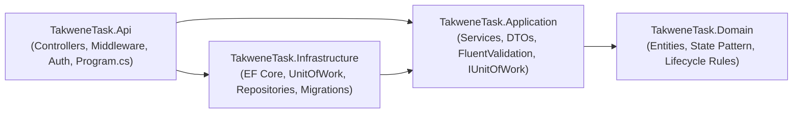
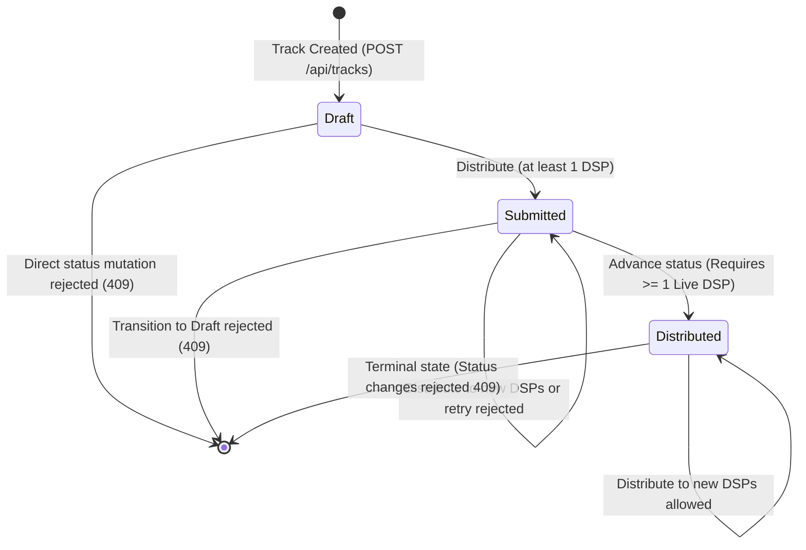

# Takwene Track Management API

Backend service for digital music catalog management, handling artists, track metadata, and distribution lifecycle state machines across digital service providers (DSPs) such as Spotify, Apple Music, and YouTube.

Built with **.NET 10**, **C# 14**, **PostgreSQL 17**, and **Clean Architecture**.

---

## Architecture Overview

The solution enforces strict compile-time dependency inversion across four isolated projects and an independent test suite:

```
backend/TakweneTask/
  docker-compose.yml              # PostgreSQL 17 database container
  .config/dotnet-tools.json       # Pinned dotnet-ef CLI manifest
  src/
    TakweneTask.Domain/           # Core Entities, State Pattern, Enums, DomainException (Zero external references)
    TakweneTask.Application/      # DTOs, Use-case Services, FluentValidation, AutoMapper, IUnitOfWork & Repositories
    TakweneTask.Infrastructure/   # PostgreSQL EF Core DbContext, Repositories, UnitOfWork, Migrations, Seed Data
    TakweneTask.Api/              # Controllers, Action Filters, JWT Auth, Serilog, OpenTelemetry, Program.cs
  tests/
    TakweneTask.Tests/            # xUnit tests for State Pattern, UnitOfWork, Services, Validators, and AutoMapper
```

### Dependency Inversion Flow



---

## Domain Lifecycle & State Pattern

Track lifecycle progression is strictly governed by the **State Pattern** encapsulated inside `TakweneTask.Domain`:



1. **`Draft`**: Initial state upon track creation. Direct status updates are forbidden. Submitting to at least one DSP transitions the track to `Submitted`.
2. **`Submitted`**: Active while distribution is in progress. Can only transition to `Distributed` if at least one DSP distribution is confirmed `Live`. Retrying rejected DSPs is permitted. All-or-nothing batch validation prevents partial mutations.
3. **`Distributed`**: Terminal business status. No further status alterations are permitted. Additional DSPs can still be added.

---

## Quick Start & Setup

### Prerequisites
- [.NET 10 SDK](https://dotnet.microsoft.com/download)
- [Docker](https://www.docker.com/) & Docker Compose

### 1. Launch PostgreSQL 17 Container
From `backend/TakweneTask`:
```bash
docker compose up -d
```
This spins up PostgreSQL 17 on `localhost:5432` with database `takwene_db` and credentials `takwene`/`takwene`.

### 2. Restore Local Tools & Apply Migrations
Restore the pinned `dotnet-ef` CLI tool and apply migrations with deterministic seed data:
```bash
dotnet tool restore
dotnet ef database update --project src/TakweneTask.Infrastructure --startup-project src/TakweneTask.Api
```

### 3. Run the API
```bash
dotnet run --project src/TakweneTask.Api
```
The API starts on `http://localhost:5000` (and `https://localhost:5001`).

### 4. Interactive Swagger UI
Open your browser to:
```
http://localhost:5000/swagger
```
Click the **Authorize** button and enter the Bearer token acquired from `/api/auth/login`.

---

## Demo Credentials

A preconfigured demo user account is provided for evaluation reviewers:

- **Username**: `demo`
- **Password**: `demo-secret-key-12345`

Send `POST /api/auth/login`:
```json
{
  "username": "demo",
  "password": "demo-secret-key-12345"
}
```
Copy the `accessToken` and supply it as `Bearer <token>` on secured endpoints.

---

## API Surface

| HTTP Method | Route | Auth | Description |
| :--- | :--- | :--- | :--- |
| `POST` | `/api/auth/login` | Public | Authenticates demo user and returns JWT token |
| `GET` | `/api/artists` | Public | Returns list of all artists |
| `POST` | `/api/artists` | Bearer JWT | Creates a new artist with ISO 3166-1 alpha-2 country |
| `GET` | `/api/tracks` | Public | Returns list of tracks (filters: `artistId`, `genre`, `status`) |
| `POST` | `/api/tracks` | Bearer JWT | Creates a new track in `draft` status |
| `GET` | `/api/tracks/{id}` | Public | Returns full track details with DSP distributions |
| `POST` | `/api/tracks/{id}/distribute` | Bearer JWT | Dispatches track to DSPs (transitions `draft` -> `submitted`) |
| `PATCH` | `/api/tracks/{id}/status` | Bearer JWT | Advances track status (requires at least one `live` DSP for `distributed`) |
| `PATCH` | `/api/tracks/{id}/distributions/{dspId}` | Bearer JWT | **Reviewer simulation endpoint**: confirms DSP distribution as `live` or `rejected` |

---

## Critical User Journey (Reviewer Testing Loop)

Use the included [`TakweneTask.http`](file:///mnt/windows/Projects/yarab/TakweneFullStackTask/backend/TakweneTask/src/TakweneTask.Api/TakweneTask.http) file or curl:

1. **Authenticate**: Call `POST /api/auth/login` to obtain a JWT.
2. **Create Track**: Call `POST /api/tracks` with title, artist ID, valid ISRC (`USRC17607839`), release date, and genre.
   * *Status is `draft`*.
3. **Attempt Premature Status Advancement**: Call `PATCH /api/tracks/{id}/status` with `{ "status": "distributed" }`.
   * *Result: HTTP 409 Conflict (State Pattern rejects direct transition from draft)*.
4. **Distribute Track**: Call `POST /api/tracks/{id}/distribute` with Spotify and Apple Music IDs.
   * *Status automatically advances to `submitted`*.
5. **Attempt Advancement Without Confirmation**: Call `PATCH /api/tracks/{id}/status` with `{ "status": "distributed" }`.
   * *Result: HTTP 409 Conflict (State Pattern enforces that at least one DSP must be live)*.
6. **Simulate DSP Confirmation**: Call `PATCH /api/tracks/{id}/distributions/{spotifyId}` with `{ "status": "live" }`.
   * *Spotify distribution is marked `live`*.
7. **Advance to Distributed**: Call `PATCH /api/tracks/{id}/status` with `{ "status": "distributed" }`.
   * *Status successfully advances to `distributed`*.
8. **Verify Terminal State**: Call `PATCH /api/tracks/{id}/status` with `{ "status": "submitted" }`.
   * *Result: HTTP 409 Conflict (Distributed is a terminal state)*.

---

## Running the Unit Test Suite

Execute the xUnit test suite covering State Pattern transitions, FluentValidation rules, and AutoMapper configuration assertions:

```bash
dotnet test tests/TakweneTask.Tests/TakweneTask.Tests.csproj
```
All unit tests run completely in-memory with zero external service dependencies.
