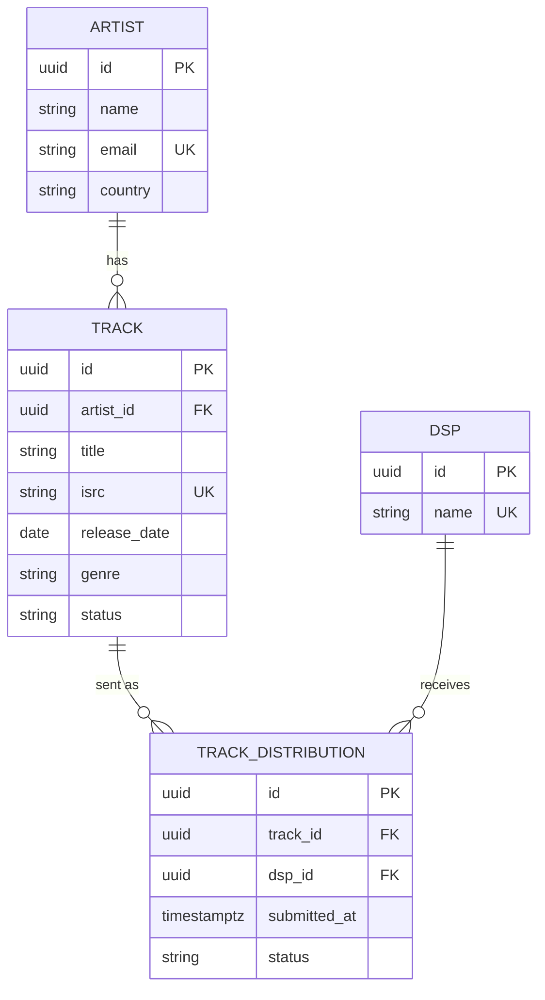
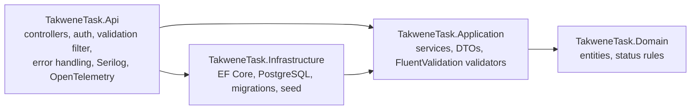

# Takwene Track Management API — Backend Plan

* **Author:** Mohamed Ayoub
* **Date:** 2026-11-10
* **Review status:** Not reviewed by Goldfish. The author stopped the review before it finished, so
  every point below comes from the drafting conversation only.

## Overview

This is the backend for the Takwene full-stack task: a .NET 10 Web API that manages artists, their
tracks, and the delivery of those tracks to DSPs (Spotify, Apple Music, YouTube). The people who use it
are the Takwene reviewers grading the task, and the Angular frontend (Task 2), which only reads data.

The plan covers everything the task grades: EF Core migrations on PostgreSQL, Clean Architecture split
into four projects, input validation with clear error responses (FluentValidation), JWT on the write
endpoints, and realistic seed data. On top of that, the author asked for:

- structured logging with Serilog, one line per request carrying the trace ID and the user;
- OpenTelemetry tracing and metrics, with the export destination chosen later;
- Mermaid diagrams (ERD and project layers) in a short README.

The deadline is 72 hours, so anything the task does not grade stays out unless it removes a dead end.

## Analysis

### Reviewer status

| Reviewer | Status |
| --- | --- |
| egm-design | not run (review stopped by author) |
| egm-codebase-details | not run (review stopped by author) |
| egm-zoom-out | not run (review stopped by author) |
| egm-comprehension | not run (review stopped by author) |
| egm-implementation-readiness | not run (review stopped by author) |
| egm-structural | not run (review stopped by author) |
| egm-inventive-catalyst | not run (review stopped by author) |

### Main contradiction and how the plan resolves it

The task defines two status fields: track status (`draft / submitted / distributed`) and distribution
status (`pending / live / rejected`). It gives an endpoint to change the track status but none to change a
distribution status. If "distributed" means "at least one DSP has the track live", then a track created
through the API can never reach `distributed`, because its distributions stay `pending` forever. Only seed
data could show the full lifecycle.

Resolution: keep the rule and add one JWT-protected endpoint,
`PATCH /api/tracks/{id}/distributions/{dspId}`, that stands in for the DSP reporting back. Its code
carries a comment saying it exists only for demo use, and the README marks it as an extra.

### Risks found while drafting

**Blocker (the plan already handles these)**

- **Clean Architecture boundaries must be enforced by the compiler.** One project with folders would let
  Domain code reference EF Core without any error. Fix: four projects with references pointing inward.
- **The FluentValidation auto-validation package is deprecated.** `FluentValidation.AspNetCore` should not
  be used. Fix: one MVC action filter that resolves `IValidator<T>` for each action argument and calls
  `ValidateAsync`. Calling the sync `Validate` on a validator that has `MustAsync` rules throws.
- **A validator cannot guarantee a unique ISRC.** Two requests at the same moment can both pass a
  "does it exist?" check. Fix: a unique index on `Track.Isrc`. The Postgres duplicate-key error
  (SQLSTATE `23505`) maps to 409. The same applies to `Artist.Email` and to the (track, DSP) pair.
- **Seeding with `HasData` and integer identity columns collides in Postgres.** Inserting explicit IDs does
  not move the sequence, so the first API insert would try ID 1 again. Fix: Guid primary keys, with fixed
  Guid values in the seed.

**Major (watch for these while implementing, especially in AI-generated code)**

- **JWT mistakes.** Common AI-generated faults: a hardcoded signing key, `ValidateLifetime = false`, no
  audience check, and plain `==` password comparison. Fix: load the key from configuration and check it
  at startup (at least 32 bytes, app refuses to start otherwise), validate issuer, audience and lifetime,
  and use `CryptographicOperations.FixedTimeEquals`. These are good material for DECISIONS.md question 2.
- **`User.Identity.Name` is empty with default JwtBearer settings.** The handler remaps claim types, so a
  `name` claim does not land where `Identity.Name` looks. Fix: `MapInboundClaims = false` and
  `TokenValidationParameters.NameClaimType = "name"`. Without this, every log line says `anonymous`.
- **Timestamps and Npgsql.** Npgsql refuses to write a `DateTime` whose `Kind` is not `Utc` into a
  `timestamp with time zone` column. Fix: always use `DateTime.UtcNow`, and build seed dates with
  `DateTimeKind.Utc`. Seed dates must be fixed values, not `UtcNow`, or every new migration rewrites them.
- **OpenTelemetry export errors on a reviewer's machine.** The OTLP exporter defaults to
  `localhost:4317` and logs failures when nothing is listening there. Fix: register tracing and metrics
  always (this also keeps `Activity.Current` set, so Serilog has a trace ID), but add the OTLP exporter
  only when `OTEL_EXPORTER_OTLP_ENDPOINT` is set.
- **Serilog takes over the logging pipeline.** With `AddSerilog`, logs do not reach other
  `ILogger` providers, so `builder.Logging.AddOpenTelemetry()` would get nothing. When the author picks an
  OpenTelemetry backend, logs should go through `Serilog.Sinks.OpenTelemetry` instead.
- **Enum values sent as numbers.** `JsonStringEnumConverter` accepts integers by default, so
  `{ "status": 99 }` would bind. Fix: `allowIntegerValues: false`, and keep `IsInEnum()` in the validators.
- **Swagger UI and the .NET 10 OpenAPI package.** `Microsoft.AspNetCore.OpenApi` in .NET 10 uses
  OpenAPI.NET 2.x. AI-generated samples for adding a bearer scheme often use the 1.x API and do not
  compile. Check the namespaces when writing the document transformer.
- **Genre filter and wildcards.** `EF.Functions.ILike(genre, input)` treats `%` and `_` in the input as
  wildcards. Fix: compare `t.Genre.ToLower() == genre.ToLower()`.

**Nit**

- `PATCH /api/tracks/{id}/status` in practice only performs `submitted → distributed`, because
  `draft → submitted` happens through distribute. The README should say so in one line so it doesn't read
  as a broken endpoint.
- Reviewers need DSP IDs to call distribute. The README lists the three seeded DSP IDs, which avoids
  adding a `GET /api/dsps` endpoint.
- DECISIONS.md must be the author's honest account. This plan was written with AI help, and it should say
  so. Keep notes during implementation of what was generated, what was changed, and why.

### Ideal final result

A reviewer clones the repo and runs three commands: Postgres starts, the migration creates the schema
with seed data, and the API runs. In Swagger they log in, create a track, distribute it, mark a
distribution live with the demo endpoint, and move the track to `distributed`. Every bad request returns
a ProblemDetails body that says which field or rule failed. Each request produces one log line whose
trace ID matches the `traceId` in the error response.

## Goals vs. Non-Goals

* **In-Scope Goals:**
  - Four projects: Domain, Application, Infrastructure, Api, plus one test project.
  - Entities Artist, Track, Dsp, TrackDistribution on PostgreSQL through EF Core, with an initial
    migration that includes the seed data.
  - The seven required endpoints, plus `POST /api/auth/login` and the demo-only distribution status
    endpoint.
  - FluentValidation for every request body. Domain status rules enforced in the `Track` entity.
  - Consistent error responses: 400, 401, 404, 409 and 500, all as ProblemDetails.
  - JWT on all write endpoints, with GET endpoints public.
  - Serilog request logging with method, path, status, duration, trace ID and user.
  - OpenTelemetry tracing (ASP.NET Core, Npgsql) and metrics (ASP.NET Core, runtime), with an optional
    OTLP exporter.
  - CORS for the Angular dev server.
  - A short README with an ERD and a layers diagram in Mermaid. Staged commits.
  - Tests for the Track status rules and the validators only.
* **Out-of-Scope Non-Goals:**
  - Pagination, sorting.
  - User accounts, registration, roles, refresh tokens, password hashing for real users.
  - Rate limiting on login. This is a known gap, worth noting in DECISIONS.md.
  - Takedowns (`distributed` is final), deleting or editing artists and tracks.
  - Real DSP integrations, webhooks, background jobs.
  - Optimistic concurrency on status changes. The unique indexes cover the race that matters.
  - Choosing or running an OpenTelemetry backend. Deployment, containerising the API.

## Alternatives Weighed

- **One project with Clean Architecture folders.** Rejected by author: nothing enforces the dependency
  direction, and enforcing it needs an architecture-test library plus a test project. That costs more
  than four `dotnet new classlib` commands.
- **Minimal APIs.** Rejected by author in favour of controllers, which .NET reviewers expect. Cost: a bit
  more code per endpoint.
- **MediatR / CQRS.** Rejected by author: commercial licence since 2025, and an extra layer of
  indirection for about nine endpoints. Plain application services instead.
- **`FluentValidation.AspNetCore` auto-validation.** Rejected: deprecated by the FluentValidation
  maintainers. Replaced by one action filter.
- **ISRC uniqueness checked only in a validator.** Rejected: two concurrent requests can both pass the
  check. The unique index is the guarantee. The validator only checks the format.
- **ASP.NET Core Identity.** Rejected: adds user tables that are not in the data model, for one demo
  account.
- **`dotnet user-jwts`.** Rejected by author: the author wants token issuing in the code, and the tool
  only works in Development.
- **Keycloak or another external identity provider.** Rejected: one more container for the reviewer to
  set up.
- **Dropping the "distributed needs a live distribution" rule.** Rejected by author: `distributed` would
  then mean "someone said so", not that a DSP has the track live.
- **Keeping the rule without the demo endpoint.** Rejected by author: tracks created through the API
  could never reach `distributed`.
- **Auto-migrate on startup.** Rejected: the README must show how to run migrations, so
  `dotnet ef database update` is the documented path.
- **Integer IDs.** Rejected: `HasData` with identity columns does not move the Postgres sequence. Guid
  keys avoid it.
- **Postgres native enum types.** Rejected: they need extra Npgsql mapping and a migration for every new
  value. Enums are stored as strings.
- **`GET /api/dsps` endpoint.** Not added: the README lists the three seeded DSP IDs. Add it if the
  frontend later needs a DSP picker.

## Key Decisions & Staging for Next Steps

### 1. Repository and solution layout

Git repo at `TakweneFullStackTask/`, covering the backend now and the frontend later. `README.md` and
`DECISIONS.md` sit at the repo root.

```
TakweneFullStackTask/
  README.md
  DECISIONS.md
  .gitignore                        # dotnet new gitignore (covers bin/, obj/, .idea/)
  backend/TakweneTask/
    TakweneTask.sln
    docker-compose.yml              # postgres:17 only
    .config/dotnet-tools.json       # local dotnet-ef tool, so reviewers run `dotnet tool restore`
    src/
      TakweneTask.Domain/           # entities, enums, DomainException; no package references
      TakweneTask.Application/      # services, DTOs, validators, IAppDbContext
      TakweneTask.Infrastructure/   # AppDbContext, EF configurations, migrations, seed data
      TakweneTask.Api/              # controllers, filters, exception handler, auth, Program.cs
    tests/
      TakweneTask.Tests/            # xUnit: Track rules + validators
```

- The existing `TakweneTask/TakweneTask.csproj` moves to `src/TakweneTask.Api/TakweneTask.Api.csproj`.
  Delete the weather-forecast sample. Update the `.sln`.
- Project references: Application → Domain. Infrastructure → Application. Api → Application and
  Infrastructure (Api is the composition root). Tests → Domain and Application.
- Each layer registers its own services: `AddApplication()`, `AddInfrastructure(configuration)`.

**Packages**

| Project | Packages |
| --- | --- |
| Domain | none |
| Application | `Microsoft.EntityFrameworkCore` (for `DbSet<T>` in `IAppDbContext`), `FluentValidation.DependencyInjectionExtensions` |
| Infrastructure | `Npgsql.EntityFrameworkCore.PostgreSQL` |
| Api | `Microsoft.EntityFrameworkCore.Design`, `Microsoft.AspNetCore.Authentication.JwtBearer`, `Microsoft.AspNetCore.OpenApi` (already there), `Swashbuckle.AspNetCore.SwaggerUI`, `Serilog.AspNetCore`, `OpenTelemetry.Extensions.Hosting`, `OpenTelemetry.Instrumentation.AspNetCore`, `OpenTelemetry.Instrumentation.Runtime`, `Npgsql.OpenTelemetry`, `OpenTelemetry.Exporter.OpenTelemetryProtocol` |
| Tests | `xunit`, `Microsoft.NET.Test.Sdk`, `xunit.runner.visualstudio` |

Use the 10.x versions of the Microsoft and Npgsql packages, matching the SDK (10.0.114).

Trade-off: Application depends on `Microsoft.EntityFrameworkCore` so `IAppDbContext` can expose
`DbSet<T>`. The alternative, one repository interface per entity, adds four interfaces and four classes
for no behaviour. Mention this choice in DECISIONS.md.

### 2. Domain model

| Entity | Fields | Notes |
| --- | --- | --- |
| `Artist` | `Id` (Guid), `Name`, `Email`, `Country` | Email unique |
| `Track` | `Id` (Guid), `Title`, `ArtistId`, `Isrc`, `ReleaseDate` (`DateOnly`), `Genre`, `Status` | ISRC unique, stored normalised (uppercase, no hyphens) |
| `Dsp` | `Id` (Guid), `Name` | Name unique |
| `TrackDistribution` | `Id` (Guid), `TrackId`, `DspId`, `SubmittedAt` (UTC `DateTime`), `Status` | Unique on (`TrackId`, `DspId`) |

- Enums: `TrackStatus { Draft, Submitted, Distributed }` and `DistributionStatus { Pending, Live, Rejected }`.
- New IDs come from `Guid.CreateVersion7()`.
- `Track` owns its `Distributions` collection and exposes the rule methods:
  - `Distribute(IReadOnlyCollection<Guid> dspIds, DateTime utcNow)`
  - `ChangeStatus(TrackStatus to)`
  - `SetDistributionStatus(Guid dspId, DistributionStatus to)`, used only by the demo endpoint
- A broken rule throws `DomainException(message)`, which becomes 409.
- `Isrc.Normalize(string)` is one static helper in Domain: uppercase and strip hyphens. The service and
  the validator both use it.

### 3. Status rules

**Track status**

| From | To | Allowed when | How |
| --- | --- | --- | --- |
| (new) | `draft` | always | `POST /api/tracks`; the client cannot set status |
| `draft` | `submitted` | at least one distribution was created | automatic, on the first successful distribute |
| `submitted` | `distributed` | at least one distribution is `live` | `PATCH /api/tracks/{id}/status` |
| `distributed` | anything | never (final; takedowns out of scope) | — |
| any other change | | never (skipping a step, going backwards, same status) | 409 `Cannot change status from X to Y.` |

**Distributions**

| Case | Result |
| --- | --- |
| Distribute to a DSP the track has never been sent to | new row, `pending`, `SubmittedAt = UtcNow` |
| Distribute to a DSP already `pending` or `live` | 409 `Track is already pending or live on <DSP>.`; nothing is saved |
| Distribute to a DSP that `rejected` it | the same row resets to `pending` with a new `SubmittedAt` (resubmission) |
| Distribute while the track is `draft` | the track becomes `submitted` |
| Distribute while the track is `submitted` or `distributed` | allowed (adds DSPs); track status unchanged |
| Demo endpoint: `pending → live` or `pending → rejected` | allowed |
| Demo endpoint: any other change | 409 |

A distribute call is all or nothing. If any DSP in the list fails a rule, nothing is saved.

### 4. Validation rules (FluentValidation, in Application)

| Request | Rules |
| --- | --- |
| `LoginRequest` | `username` and `password` required |
| `CreateArtistRequest` | `name` required, max 200; `email` required, `EmailAddress()`, max 254; `country` exactly 2 uppercase letters (ISO 3166-1 alpha-2, e.g. `EG`) |
| `CreateTrackRequest` | `title` required, max 200; `artistId` not empty and must exist (`MustAsync` against `IAppDbContext`); `isrc` required, and after `Isrc.Normalize` must match `^[A-Z]{2}[A-Z0-9]{3}\d{7}$` (country, registrant, year, 5-digit number, e.g. `EG-TKW-24-00001`); `releaseDate` required; `genre` required, max 50 |
| `DistributeTrackRequest` | `dspIds` not empty, no duplicates, every ID must exist (`MustAsync`) |
| `UpdateTrackStatusRequest` | `status` required, `IsInEnum()` |
| `UpdateDistributionStatusRequest` (demo) | `status` must be `live` or `rejected` |

- Validators are registered with `AddValidatorsFromAssemblyContaining<CreateArtistRequestValidator>()`.
- `FluentValidationActionFilter` is registered globally in the Api. For each action argument, it resolves
  `IValidator<TArg>` from `RequestServices` and calls `ValidateAsync`. On failure, it sets
  `context.Result` to a 400 `ValidationProblemDetails` with errors listed per field.
- Malformed JSON and wrong types are rejected first by `[ApiController]` model binding, which uses the
  same `ValidationProblemDetails` shape.
- Existence checks in validators are safe here because there are no delete endpoints, and the foreign
  keys still guard the database.

### 5. Error responses

All errors are ProblemDetails (`AddProblemDetails()`). The body includes `traceId`, which contains the
same trace ID as the request's log line.

| Status | When | Produced by |
| --- | --- | --- |
| 400 | invalid body or field | `[ApiController]` binding or `FluentValidationActionFilter` |
| 401 | missing or invalid token; wrong login | JwtBearer; `AuthController` returns `Invalid username or password.` |
| 404 | `{id}` or `{dspId}` in the route not found | service throws `NotFoundException` |
| 409 | status rule broken; duplicate ISRC, email or (track, DSP) | `DomainException`, or `DbUpdateException` wrapping `PostgresException` with SqlState `23505` |
| 500 | anything else | generic message, no stack trace, logged at Error level |

One `GlobalExceptionHandler : IExceptionHandler` in the Api does all of the mapping.

### 6. Endpoints

| Method | Route | Auth | Request → Response |
| --- | --- | --- | --- |
| POST | `/api/auth/login` | public | `{ username, password }` → `200 { accessToken, expiresAt }` |
| POST | `/api/artists` | JWT | `{ name, email, country }` → `201` + Location, artist |
| GET | `/api/artists` | public | → `200 [artist]` |
| POST | `/api/tracks` | JWT | `{ title, artistId, isrc, releaseDate, genre }` → `201` + Location, track (status `draft`) |
| GET | `/api/tracks?artistId=&genre=&status=` | public | → `200 [{ id, title, isrc, genre, status, releaseDate, artistId, artistName }]` |
| GET | `/api/tracks/{id}` | public | → `200 { ...track, artistName, distributions: [{ dspId, dspName, status, submittedAt }] }` |
| POST | `/api/tracks/{id}/distribute` | JWT | `{ dspIds: [guid] }` → `200` track detail |
| PATCH | `/api/tracks/{id}/status` | JWT | `{ status }` → `200` track detail |
| PATCH | `/api/tracks/{id}/distributions/{dspId}` | JWT | **demo only.** `{ status: "live" \| "rejected" }` → `200` track detail |

- Controllers: `AuthController`, `ArtistsController`, `TracksController`, with `[ApiController]`,
  `ActionResult<T>`, and `[Authorize]` on each write action.
- The demo action carries this comment:
  `// Demo only: stands in for a DSP reporting back. Not part of the task spec; a real system would receive this from the DSP (webhook/feed).`
- Enums travel as camelCase strings (`"draft"`, `"live"`), using
  `JsonStringEnumConverter(JsonNamingPolicy.CamelCase, allowIntegerValues: false)`. They are stored as
  strings in the database (`HasConversion<string>()`).
- Filters on `GET /api/tracks` are all optional and combine with AND. `genre` is a case-insensitive exact
  match.
- Update `TakweneTask.http` with one sample request per endpoint, including login.

### 7. JWT design

- Configuration:
  ```json
  "Jwt": { "Issuer": "takwene-api", "Audience": "takwene-clients", "SigningKey": "<at least 32 bytes>" },
  "DemoUser": { "Username": "demo", "Password": "<dev value>" }
  ```
  The dev values live in `appsettings.Development.json`, and the README shows them. Any other environment
  sets `Jwt__SigningKey` and `DemoUser__Password` as environment variables.
- `JwtOptions` are bound with `.Validate(key length >= 32 bytes).ValidateOnStart()`, so the app refuses to
  start without a usable key.
- Issuing: `JsonWebTokenHandler` (Microsoft.IdentityModel.JsonWebTokens) with HS256 and a 60-minute
  expiry. Claims are `sub` and `name` (the username) and `jti`.
- Validation: issuer, audience, lifetime and signing key all checked. `ClockSkew` is 1 minute.
  `MapInboundClaims = false` and `NameClaimType = "name"`.
- Login compares the username and password with `CryptographicOperations.FixedTimeEquals` on UTF-8
  bytes. A failure returns 401 with no hint about which part was wrong.
- Never log the password or the token.

### 8. Logging (Serilog)

- `builder.Services.AddSerilog((services, cfg) => cfg.ReadFrom.Configuration(...).ReadFrom.Services(services).Enrich.FromLogContext())`.
  The Console sink is configured in `appsettings.json`.
- Console output template, which includes the trace ID:
  `[{Timestamp:HH:mm:ss} {Level:u3}] {TraceId} {Message:lj}{NewLine}{Exception}`.
  Serilog reads `TraceId` and `SpanId` from `Activity.Current`.
- `app.UseSerilogRequestLogging(o => { ... })` writes one summary line per request:
  - `MessageTemplate = "HTTP {RequestMethod} {RequestPath} responded {StatusCode} in {Elapsed:0.0} ms (user: {User})"`
  - `EnrichDiagnosticContext` sets `User` to `http.User.Identity?.Name ?? "anonymous"`. This runs when the
    request ends, so the user is known by then.
- Example line:
  `[14:02:11 INF] 4bf92f3577b34da6a3ce929d0e0e4736 HTTP POST /api/tracks/0193.../distribute responded 409 in 12.4 ms (user: demo)`
- Lower `Microsoft.AspNetCore` to Warning, so the per-request line is the only request log.
- No request bodies in logs.

### 9. OpenTelemetry

```csharp
var otel = builder.Services.AddOpenTelemetry()
    .ConfigureResource(r => r.AddService("takwene-api"))
    .WithTracing(t => t.AddAspNetCoreInstrumentation().AddNpgsql())
    .WithMetrics(m => m.AddAspNetCoreInstrumentation().AddRuntimeInstrumentation());

// ponytail: export only when a destination is configured; backend chosen later
if (!string.IsNullOrWhiteSpace(builder.Configuration["OTEL_EXPORTER_OTLP_ENDPOINT"]))
    otel.UseOtlpExporter();
```

- Tracing is always registered. This keeps `Activity.Current` set, so Serilog has trace IDs even when
  nothing is exported.
- Later, when the destination is chosen: set `OTEL_EXPORTER_OTLP_ENDPOINT` (and
  `OTEL_EXPORTER_OTLP_PROTOCOL` if needed), and add `Serilog.Sinks.OpenTelemetry` to send logs on the
  same path.

### 10. Program.cs pipeline order

```
UseExceptionHandler → UseSerilogRequestLogging → UseCors → UseAuthentication → UseAuthorization → MapControllers
```

Development only: `MapOpenApi()` and the Swagger UI pointed at `/openapi/v1.json`. Add a bearer security
scheme through an OpenAPI document transformer, written against the OpenAPI.NET 2.x API. CORS origins
come from `Cors:AllowedOrigins` (default `http://localhost:4200`), never `AllowAnyOrigin`.

### 11. Database, migrations and seed data

- `docker-compose.yml`: `postgres:17`, port 5432, database, user and password all `takwene`, plus a
  named volume.
- `ConnectionStrings:Default` in `appsettings.Development.json`:
  `Host=localhost;Port=5432;Database=takwene;Username=takwene;Password=takwene`.
- One `IEntityTypeConfiguration<T>` per entity: max lengths, unique indexes, enum-to-string conversion,
  and `OnDelete(Restrict)` on foreign keys.
- Migration commands (run from `backend/TakweneTask/`):
  ```
  dotnet tool restore
  dotnet ef migrations add InitialCreate --project src/TakweneTask.Infrastructure --startup-project src/TakweneTask.Api
  dotnet ef database update --project src/TakweneTask.Infrastructure --startup-project src/TakweneTask.Api
  ```
- Seed with `HasData`, using fixed Guids and fixed UTC dates, so it is part of the `InitialCreate`
  migration. Use fictional artists, not real people.

| Kind | Seed |
| --- | --- |
| DSPs (3) | Spotify, Apple Music, YouTube |
| Artists (4) | Nour El Sabah (EG), Layla Haddad (LB), Omar Al-Rashid (SA), Yasmine Benali (MA) |
| Tracks (10) | Genres: Mahraganat, Arabic Pop, Khaleeji, Rai, Hip-Hop, Shaabi. Statuses: 3 `draft`, 3 `submitted`, 4 `distributed` |
| Distributions | `draft` tracks: none. `submitted` tracks: `pending` rows, one also has a `rejected` row. `distributed` tracks: at least one `live` row each, one with a `pending` row as well |

ISRCs follow the pattern `EGTKW2400001`. Every seed row must obey the status rules in section 3.

### 12. Tests (one project, no extra frameworks)

- `TrackTests`: covers each row of the two tables in section 3, including the all-or-nothing behaviour
  of distribute.
- `ValidatorTests`: ISRC accepted with and without hyphens, wrong length rejected, lowercase normalised,
  country code rules, duplicate `dspIds` rejected.

### 13. README outline (keep it short)

1. One paragraph on what the project is.
2. Prerequisites: .NET 10 SDK, Docker.
3. Run: `docker compose up -d` → `dotnet tool restore` → `dotnet ef database update ...` →
   `dotnet run --project src/TakweneTask.Api`. Then the Swagger URL.
4. Get a JWT: one `curl` call to `/api/auth/login` with the demo credentials, then send the result as
   `Authorization: Bearer <token>`.
5. Endpoints table, with the demo-only endpoint marked, plus the seeded DSP IDs.
6. Diagrams: the ERD and layers diagrams below.
7. Observability, in one line: set `OTEL_EXPORTER_OTLP_ENDPOINT` to export traces and metrics.

**ERD**



**Layers**



Arrows point in the direction of the project references. Domain references nothing.

### 14. Commit stages

1. `chore: init repo, gitignore, solution with four projects and test project`
2. `feat(domain): entities, enums, track status rules`
3. `test(domain): track status rule tests`
4. `feat(infrastructure): DbContext, entity configurations, Postgres, docker compose`
5. `feat(infrastructure): initial migration with seed data`
6. `feat(application): DTOs, services, FluentValidation validators and tests`
7. `feat(api): controllers, validation filter, global exception handler`
8. `feat(auth): JWT login endpoint, protect write endpoints`
9. `feat(observability): Serilog request logging, OpenTelemetry tracing and metrics`
10. `feat(api): demo-only distribution status endpoint`
11. `docs: README with setup, migrations, JWT and diagrams`
12. `docs: DECISIONS.md` (written by the author from their own notes)

### 15. Open items before or during implementation

- Re-run a Goldfish review on this brief if time allows (`/egm:egm-review`), since none of the seven
  lenses ran.
- Keep a running note of AI-generated code that had to be fixed, for DECISIONS.md. The "Major" risks
  above are the likely candidates.
