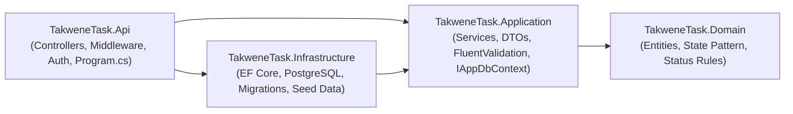
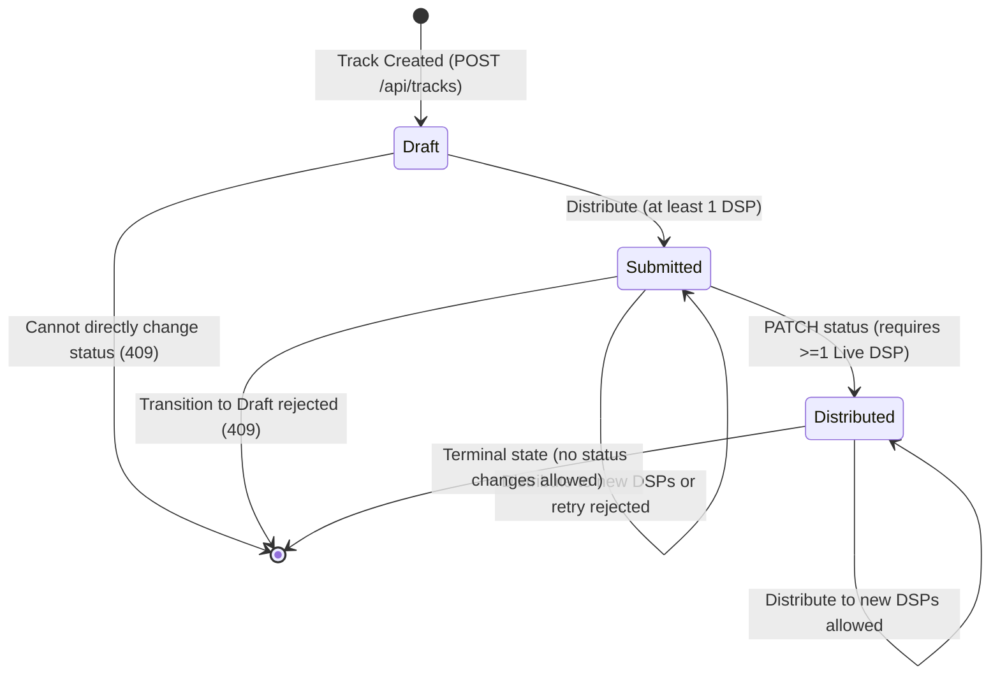
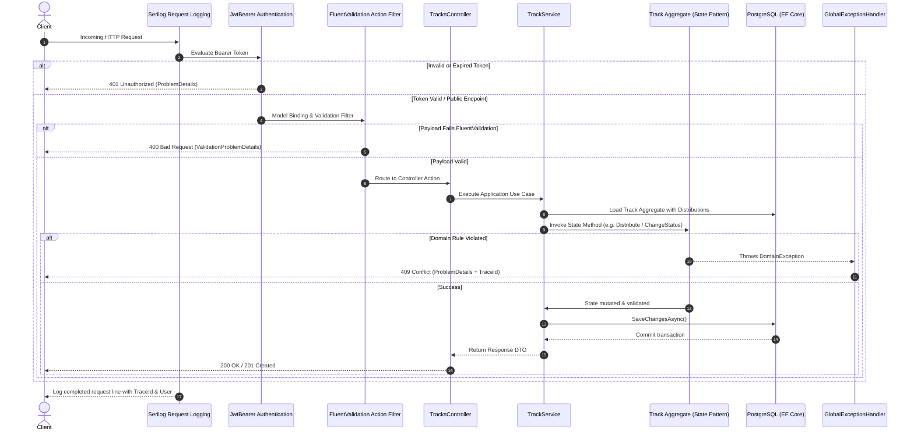

# Takwene Track Management API

* **Author:** Mohamed Ayoub
* **Status:** Draft
* **Date:** 2026-11-10

---

## Overview

The Takwene Track Management API is a backend service for digital music catalog management, handling artists, track metadata, and the distribution lifecycle across digital service providers (DSPs) such as Spotify, Apple Music, and YouTube. The system serves as the core data engine for evaluation reviewers and provides a read-only integration surface for an Angular single-page application.

The design enforces strict catalog validation, domain-driven lifecycle state transitions using the State Pattern, compile-time architectural boundary enforcement via a four-project Clean Architecture layout in .NET 10, and relational persistence on PostgreSQL using Entity Framework Core. Structured observability with Serilog and OpenTelemetry is embedded across the request lifecycle.

---

## The Problem

Independent music distribution platforms require high data integrity and predictable status transitions before catalog assets are delivered to streaming services. The system addresses three distinct operational problems:

1. **Catalog Integrity and Uniqueness Guarantees**: Track metadata—specifically International Standard Recording Codes (ISRC), artist identifiers, and country formats—frequently suffers from data corruption, formatting discrepancies, and duplicate entry races. In-memory validation alone cannot prevent concurrent race conditions for unique business identifiers across distributed clients.
2. **Lifecycle Enforcement and State Deadlocks**: The domain defines a strict progression for track readiness (`draft` -> `submitted` -> `distributed`) dependent on distribution outcomes across DSPs (`pending`, `live`, `rejected`). Without explicit domain rules, tracks can be falsely marked as distributed without confirmation, or permanently trapped in pending states during testing due to the absence of asynchronous external DSP webhooks.
3. **Reproducibility and Architectural Rigor**: Assessment reviewers require a self-contained runtime environment that launches deterministically via containerization, verifies dependency boundaries at compile time rather than through runtime conventions, provides RFC 9457 standard error payloads with trace correlation, and avoids unnecessary operational dependencies within a 72-hour delivery scope.

---

## Goals

* **Compile-Time Layer Isolation**: Enforce dependency inversion using a four-project Clean Architecture solution (`TakweneTask.Domain`, `TakweneTask.Application`, `TakweneTask.Infrastructure`, `TakweneTask.Api`) where project references ensure Domain depends on no external packages.
* **Deterministic Relational Persistence**: Automate schema creation and realistic seed data (3 DSPs, 4 artists, 10 tracks with varying lifecycle states) using Entity Framework Core migrations on PostgreSQL 17 via Docker Compose, utilizing fixed Version 7 UUIDs to prevent sequence collisions.
* **Domain Lifecycle State Pattern**: Implement the State Pattern in the Domain layer to govern Track lifecycle states (`Draft`, `Submitted`, `Distributed`), encapsulating valid transition paths and disallowing illegal operations directly within domain state objects.
* **Full Required API Surface**: Implement REST endpoints for artist management, track authoring, track distribution dispatch, track status progression, and an explicit JWT authentication endpoint (`/api/auth/login`).
* **Interactive Testing Loop (DSP Simulation)**: Expose a dedicated, secured test endpoint (`PATCH /api/tracks/{id}/distributions/{dspId}`) to simulate DSP callback confirmations (`pending` -> `live` / `rejected`), resolving the lifecycle deadlock during review.
* **Automated Object Transformation (AutoMapper)**: Centralize entity-to-DTO projections using AutoMapper profiles in `TakweneTask.Application`, backed by configuration assertion unit tests to ensure schema parity.
* **Strict Validation and Error Contracts**: Validate all incoming payloads using FluentValidation via an MVC action filter, mapping all validation failures and unhandled exceptions to standardized RFC 9457 `ProblemDetails` with embedded trace IDs.
* **Correlated Request Observability**: Log single-line structured request summaries via Serilog containing HTTP method, route, status code, duration, authenticated identity, and W3C trace identifiers, coupled with OpenTelemetry tracing and runtime metrics.
* **Isolated Domain Testing**: Provide comprehensive unit tests covering track state transitions, distribution constraints, and payload validation rules.

---

## Non-Goals

* **User and Role Management**: No user registration, role-based access control (RBAC), password reset flows, or refresh token mechanisms; a single preconfigured demo account satisfies the authentication requirement.
* **Brute-Force and Rate Limiting Protection**: Rate limiting on authentication endpoints is excluded from the initial deliverable to minimize dependency overhead.
* **Real External DSP Handoff**: No live integrations, HTTP calls, or webhooks to production DSP APIs (Spotify, Apple Music, YouTube); all distribution tracking is modeled within the local database.
* **Catalog Mutations and Takedowns**: No track or artist deletion, metadata editing after creation, or track takedown mechanics (`distributed` is modeled as a terminal state).
* **Pagination and Dynamic Sorting**: Endpoints return complete collections without pagination cursor management or multi-column sorting parameters.
* **Optimistic Concurrency Control**: No row versioning (`xmin` / timestamp tokens) on track updates; database unique indexes govern critical concurrency boundaries.
* **External Telemetry Infrastructure**: No bundled OpenTelemetry collector, Jaeger, or Prometheus containers; telemetry is configured via environment variables for external consumption.

---

## Open Questions

* **Question 1: Persistence mapping for the State Pattern**: How should the Domain State Pattern state classes be represented during Entity Framework Core persistence without incurring ORM mapping complexity?
  * *Resolution*: The `Track` entity maintains a private/internal `TrackStatus Status` property mapped to a PostgreSQL string column (`draft`, `submitted`, `distributed`). Upon instantiation or EF Core materialization, `Track` initializes an internal `ITrackState _state` using a domain factory method (`TrackStateFactory.Create(this, Status)`). All lifecycle methods delegate to `_state`. When transitioning states, the concrete state updates both `_state` and the persistent `Status` property. This maintains clean relational schemas and fast query projections without requiring Table-per-Hierarchy (TPH) inheritance or complex EF shadow state.

---

## Critical User Journeys (CUJs)

### CUJ 1: Track Creation, Distribution, and Lifecycle Advancement
* **Given**: An authenticated client with a valid JWT token, an existing artist record, and active DSPs seeded in the database.
* **When**:
  1. The client sends `POST /api/tracks` with title, artist ID, valid ISRC, release date, and genre.
  2. The client sends `POST /api/tracks/{id}/distribute` with an array of valid DSP IDs.
  3. The client calls the demo simulation endpoint `PATCH /api/tracks/{id}/distributions/{dspId}` with status `live`.
  4. The client sends `PATCH /api/tracks/{id}/status` with target status `distributed`.
* **Then**:
  1. The track is created in `draft` state with a 201 Created status and Location header.
  2. The distribution records are created as `pending`, and the track automatically transitions from `draft` to `submitted`.
  3. The specific DSP distribution row updates to `live`.
  4. The track transitions to `distributed`. All subsequent status updates are rejected as terminal.

### CUJ 2: Validation Rejection and Standardized Error Contract
* **Given**: A client submitting a payload with a malformed ISRC (e.g., lower-case characters, incorrect segment lengths) and missing title.
* **When**: The client sends `POST /api/tracks` with the invalid payload.
* **Then**: The MVC action filter intercepts execution before service invocation and returns HTTP 400 `ValidationProblemDetails`. The response contains error messages keyed by field (`isrc`, `title`) and includes an RFC 9457 `traceId` matching the request's structured log entry.

### CUJ 3: Domain State Pattern Enforces Lifecycle Invariants
* **Given**: A newly created track in `draft` status with zero distributions.
* **When**: The client attempts to skip the lifecycle by sending `PATCH /api/tracks/{id}/status` with `{ "status": "distributed" }`.
* **Then**: The `Track` entity's active `DraftTrackState` rejects the call and raises a `DomainException("Cannot change status from draft to distributed.")`. The global exception handler captures the domain exception and returns HTTP 409 Conflict with the exact rule violation and trace ID.

---

## Technical Plan (Architecture)

### 1. Architectural Boundaries & Project Structure

The solution enforces strict compile-time dependency inversion using four isolated class libraries and one test project:

```
TakweneFullStackTask/
  README.md
  DECISIONS.md
  .gitignore
  backend/TakweneTask/
    TakweneTask.sln
    docker-compose.yml              # postgres:17 container
    .config/dotnet-tools.json       # dotnet-ef local manifest
    src/
      TakweneTask.Domain/           # Entities, Enums, State Pattern, DomainException (Zero external references)
      TakweneTask.Application/      # DTOs, Services, FluentValidation, IAppDbContext interface
      TakweneTask.Infrastructure/   # AppDbContext, EF Core configurations, Migrations, Seed data
      TakweneTask.Api/              # Controllers, Filters, JWT Auth, Serilog, OpenTelemetry, Program.cs
    tests/
      TakweneTask.Tests/            # xUnit tests for Domain State Pattern and Application Validators
```

#### Layer Dependency Rules
* `Domain`: Has zero project or NuGet dependencies. Contains core business logic, entities, and state classes.
* `Application`: References `Domain`. Contains business use cases, DTO definitions, AutoMapper profiles, FluentValidation validators, and interfaces (`IAppDbContext`). Depends on `AutoMapper`, `FluentValidation.DependencyInjectionExtensions`, and `Microsoft.EntityFrameworkCore` (strictly for `DbSet<T>` interface abstraction).
* `Infrastructure`: References `Application`. Contains EF Core PostgreSQL configurations, DbContext implementation, migrations, and seed data.
* `Api`: References `Application` and `Infrastructure`. Serves as the composition root, registering dependency injection modules (`AddApplication()`, `AddInfrastructure()`) and hosting HTTP middleware.



---

### 2. Domain Model & State Pattern Design

#### Data Model Specification

| Entity | Primary Key | Key Attributes | Relational Constraints & Rules |
| :--- | :--- | :--- | :--- |
| `Artist` | `Id` (Guid v7) | `Name` (max 200), `Email` (max 254), `Country` (char 2) | Unique index on `Email`. Foreign key target for `Track`. |
| `Track` | `Id` (Guid v7) | `Title` (max 200), `ArtistId` (Guid), `Isrc` (char 12), `ReleaseDate` (`DateOnly`), `Genre` (max 50), `Status` (enum string) | Unique index on `Isrc`. Normalised uppercase without hyphens. Owns `Distributions`. |
| `Dsp` | `Id` (Guid v7) | `Name` (max 100) | Unique index on `Name`. Static catalog of providers (Spotify, Apple Music, YouTube). |
| `TrackDistribution` | `Id` (Guid v7) | `TrackId` (Guid), `DspId` (Guid), `SubmittedAt` (UTC `DateTime`), `Status` (enum string) | Composite unique index on (`TrackId`, `DspId`). Status: `pending`, `live`, `rejected`. |

#### State Pattern Implementation Architecture

The lifecycle of a track is governed by the State Pattern in `TakweneTask.Domain`. Status transitions and distribution mutations are delegated by `Track` to an encapsulated `ITrackState` instance.



#### State Behavior Contract

```csharp
// Domain abstraction for Track lifecycle state
public interface ITrackState
{
    TrackStatus Status { get; }
    void Distribute(Track track, IReadOnlyCollection<Guid> dspIds, DateTime utcNow);
    void ChangeStatus(Track track, TrackStatus newStatus);
}
```

1. **`DraftTrackState`**:
   * Initial state assigned on track creation.
   * `Distribute(track, dspIds, utcNow)`: Validates that `dspIds` is non-empty. Creates a new `TrackDistribution` with status `Pending` for each DSP. Upon successful addition, transitions the track to `SubmittedTrackState` and sets `track.Status = TrackStatus.Submitted`.
   * `ChangeStatus(track, newStatus)`: Throws `DomainException("Cannot change status directly from draft. A track must be distributed to at least one DSP to become submitted.")`.
2. **`SubmittedTrackState`**:
   * Active once a track has been submitted to one or more DSPs.
   * `Distribute(track, dspIds, utcNow)`:
     * For DSPs not yet distributed to: adds a new `TrackDistribution` with status `Pending`.
     * For DSPs with status `Rejected`: resets status to `Pending` and updates `SubmittedAt = utcNow`.
     * For DSPs already `Pending` or `Live`: throws `DomainException("Track is already pending or live on [DSP].")`.
     * All-or-nothing execution: if any DSP in the batch fails validation, the entire operation throws and no changes persist.
   * `ChangeStatus(track, newStatus)`:
     * If `newStatus == TrackStatus.Distributed`: checks whether `track.Distributions.Any(d => d.Status == DistributionStatus.Live)`. If true, transitions track to `DistributedTrackState` and sets `track.Status = TrackStatus.Distributed`. If no DSP is live, throws `DomainException("Track cannot be marked distributed until at least one DSP distribution is live.")`.
     * For any other target status (e.g. `Draft`, `Submitted`): throws `DomainException("Cannot change status from submitted to [target].")`.
3. **`DistributedTrackState`**:
   * Terminal business status.
   * `Distribute(track, dspIds, utcNow)`: Allows distributing the track to additional DSPs that have not yet received it, following the same validation rules as `SubmittedTrackState`.
   * `ChangeStatus(track, newStatus)`: Throws `DomainException("Track is already distributed. Status changes from distributed are not permitted.")`.

#### Persistence Mapping Strategy
To avoid complex ORM inheritance hierarchies in PostgreSQL:
* The `Track` entity exposes a public getter and private setter: `public TrackStatus Status { get; private set; }`.
* EF Core maps `Status` directly to a string column using `HasConversion<string>()`.
* An internal field `private ITrackState _state;` holds the active state object.
* `Track` defines an internal method `internal void SetState(ITrackState state, TrackStatus status)` used by state classes to synchronize the active state and the persistent enum.
* A private constructor used by EF Core and the public creation factory initializes `_state` via `TrackStateFactory.Create(this, Status)`.

---

### 3. API Surface & Contract Specification

All endpoints communicate via JSON. Date formats follow ISO 8601 (`YYYY-MM-DD` for release dates, UTC RFC 3339 for timestamps). Enums serialize as camelCase strings (`draft`, `submitted`, `distributed`, `pending`, `live`, `rejected`).

| HTTP Method | Route | Authorization | Request Body / Parameters | Success Status & Response | Error Responses |
| :--- | :--- | :--- | :--- | :--- | :--- |
| `POST` | `/api/auth/login` | Public | `{ username, password }` | `200 OK` `{ accessToken, expiresAt }` | `400 Bad Request`<br/>`401 Unauthorized` |
| `POST` | `/api/artists` | Bearer JWT | `{ name, email, country }` | `201 Created` + `Location`<br/>`{ id, name, email, country }` | `400 Bad Request`<br/>`401 Unauthorized`<br/>`409 Conflict` (Email duplicate) |
| `GET` | `/api/artists` | Public | None | `200 OK` `[{ id, name, email, country }]` | None |
| `POST` | `/api/tracks` | Bearer JWT | `{ title, artistId, isrc, releaseDate, genre }` | `201 Created` + `Location`<br/>`{ id, title, isrc, releaseDate, genre, status, artistId }` | `400 Bad Request`<br/>`401 Unauthorized`<br/>`404 Not Found` (Artist)<br/>`409 Conflict` (ISRC duplicate) |
| `GET` | `/api/tracks` | Public | Query: `artistId`, `genre`, `status` | `200 OK` `[{ id, title, isrc, releaseDate, genre, status, artistId, artistName }]` | `400 Bad Request` (Invalid status enum) |
| `GET` | `/api/tracks/{id}` | Public | Route: `id` (Guid) | `200 OK`<br/>`{ id, title, isrc, releaseDate, genre, status, artistId, artistName, distributions: [{ dspId, dspName, status, submittedAt }] }` | `404 Not Found` |
| `POST` | `/api/tracks/{id}/distribute` | Bearer JWT | Route: `id`<br/>Body: `{ dspIds: [Guid] }` | `200 OK` (Full track detail) | `400 Bad Request`<br/>`401 Unauthorized`<br/>`404 Not Found`<br/>`409 Conflict` (Duplicate/pending DSP) |
| `PATCH` | `/api/tracks/{id}/status` | Bearer JWT | Route: `id`<br/>Body: `{ status }` | `200 OK` (Full track detail) | `400 Bad Request`<br/>`401 Unauthorized`<br/>`404 Not Found`<br/>`409 Conflict` (State violation) |
| `PATCH` | `/api/tracks/{id}/distributions/{dspId}` | Bearer JWT | Route: `id`, `dspId`<br/>Body: `{ status }` (`live` \| `rejected`) | `200 OK` (Full track detail)<br/>*(Demo-only test simulation)* | `400 Bad Request`<br/>`401 Unauthorized`<br/>`404 Not Found`<br/>`409 Conflict` |

---

### 4. Request Processing Pipeline & Middleware Flow



---

### 5. Validation Architecture (FluentValidation)

Validation logic resides strictly in `TakweneTask.Application`.
* **Execution Mechanism**: Custom `FluentValidationActionFilter` registered globally in `TakweneTask.Api`. For each action parameter, the filter resolves `IValidator<T>` from `HttpContext.RequestServices` and invokes `ValidateAsync`.
* **Standardized Error Representation**: On validation failure, execution short-circuits, returning HTTP 400 with `ValidationProblemDetails` containing an errors dictionary grouped by property name.
* **Format Normalization & Rules**:
  * `CreateArtistRequestValidator`: `Name` non-empty (max 200); `Email` non-empty, RFC email format (max 254); `Country` exactly two uppercase ISO 3166-1 alpha-2 letters.
  * `CreateTrackRequestValidator`: `Title` non-empty (max 200); `ArtistId` non-empty and verified via asynchronous database check (`MustAsync`); `Isrc` non-empty, normalized via `Isrc.Normalize(string)` to uppercase stripped of hyphens, matching regex `^[A-Z]{2}[A-Z0-9]{3}\d{7}$`; `ReleaseDate` valid date; `Genre` non-empty (max 50).
  * `DistributeTrackRequestValidator`: `DspIds` collection non-empty, contains no duplicate IDs, and each ID verified against the database.
  * `UpdateTrackStatusRequestValidator`: `Status` non-empty, matches valid `TrackStatus` enum string.
  * `UpdateDistributionStatusRequestValidator`: `Status` must be either `live` or `rejected`.

---

### 6. Relational Persistence & Migration Design

* **Database Engine**: PostgreSQL 17 running via Docker Compose (`backend/TakweneTask/docker-compose.yml`) exposing port 5432 with persistent named volume storage.
* **Entity Configurations**: Explicit `IEntityTypeConfiguration<T>` implementations in `TakweneTask.Infrastructure`:
  * All primary keys use `Guid.CreateVersion7()` generated sequentially.
  * `Artist`: Unique index on `Email`. Foreign key constraint with `OnDelete(DeleteBehavior.Restrict)`.
  * `Track`: Unique index on `Isrc`. Enum `Status` stored as string (`HasConversion<string>()`).
  * `Dsp`: Unique index on `Name`.
  * `TrackDistribution`: Composite unique index on `(TrackId, DspId)`. Enum `Status` stored as string (`HasConversion<string>()`).
* **Concurrency & Race Condition Handling**: Postgres duplicate key errors (SQLSTATE `23505`) on unique indexes (`Isrc`, `Email`, `TrackDistribution`) are captured by `GlobalExceptionHandler` and translated to HTTP 409 Conflict.
* **Deterministic Seed Data**: Embedded within the initial EF Core migration (`HasData`) using static Guid constants and UTC dates:
  * 3 DSPs: Spotify, Apple Music, YouTube.
  * 4 Artists: Nour El Sabah (EG), Layla Haddad (LB), Omar Al-Rashid (SA), Yasmine Benali (MA).
  * 10 Tracks: Diverse genres (Mahraganat, Arabic Pop, Khaleeji, Rai, Hip-Hop, Shaabi) across lifecycle stages (3 `draft`, 3 `submitted`, 4 `distributed`).
  * Distributions: Accompanying distributions matching the status requirements (draft tracks have none; submitted tracks have pending/rejected rows; distributed tracks have at least one live row).

---

### 7. Observability, Logging & Security

* **Structured Logging (Serilog)**:
  * Console sink configured with template: `[{Timestamp:HH:mm:ss} {Level:u3}] {TraceId} {Message:lj}{NewLine}{Exception}`.
  * Per-request summary emitted via `app.UseSerilogRequestLogging()`:
    * `MessageTemplate = "HTTP {RequestMethod} {RequestPath} responded {StatusCode} in {Elapsed:0.0} ms (user: {User})"`.
    * `EnrichDiagnosticContext` extracts `httpContext.User.Identity?.Name ?? "anonymous"`.
  * Internal framework logging (`Microsoft.AspNetCore`) suppressed to `Warning` to ensure clean log streams.
* **OpenTelemetry Instrumentation**:
  * Distributed tracing registered via `.WithTracing(t => t.AddAspNetCoreInstrumentation().AddNpgsql())`.
  * Metrics registered via `.WithMetrics(m => m.AddAspNetCoreInstrumentation().AddRuntimeInstrumentation())`.
  * Exporter conditionally enabled only when `OTEL_EXPORTER_OTLP_ENDPOINT` environment variable is defined.
* **Security & JWT Architecture**:
  * Signing key loaded from configuration and strictly verified at startup (`key.Length >= 32` bytes via `ValidateOnStart()`).
  * Token generation uses `JsonWebTokenHandler` with HMAC-SHA256, 60-minute expiration, and standard claims (`sub`, `name`, `jti`).
  * Demo credentials configured in `appsettings.Development.json` (`demo` / developer password), evaluated using constant-time comparison via `CryptographicOperations.FixedTimeEquals`.
  * Claims mapping configured with `MapInboundClaims = false` and `TokenValidationParameters.NameClaimType = "name"` to prevent claims remapping from obscuring identity logs.


---

## Alternatives Considered

### Alternative 1: Single Project with Folder-Based Clean Architecture
* **Pros**: Eliminates multiple project files and simplifies initial solution setup.
* **Cons**: Does not enforce dependency inversion at compile time; developers can accidentally reference infrastructure or database types directly in domain logic without compiler warnings.
* **Reason for Rejection**: Rejected by author: Enforcing architectural boundaries in a single project requires introducing an architecture-test library (e.g. NetArchTest) and an extra test harness, which carries greater operational overhead than four clean class libraries with inward project references.

### Alternative 2: Minimal APIs Instead of Controllers
* **Pros**: Slightly reduces boilerplate per endpoint; aligns with modern lightweight ASP.NET Core defaults.
* **Cons**: Less familiar to enterprise .NET evaluators; action filters require different endpoint filter pipelines; Swagger/OpenAPI documentation transformers require extra configuration.
* **Reason for Rejection**: Rejected by author: Traditional API controllers provide standard convention-based action filter pipelines (`IActionFilter`) and represent standard patterns expected by .NET reviewers for multi-layer architectures.

### Alternative 3: MediatR and CQRS Architecture
* **Pros**: Decouples HTTP controllers completely from business handlers via command and query message contracts.
* **Cons**: Commercial licensing changes (since 2025); introduces significant layer indirection, multiple files per operation, and runtime assembly scanning for nine straightforward CRUD and workflow endpoints.
* **Reason for Rejection**: Rejected by author: Commercial licensing restrictions and excessive structural indirection for a compact domain scope. Plain application service classes provide direct execution paths without message dispatch overhead.

### Alternative 4: Generic Repository and Unit of Work Layer
* **Pros**: Completely abstracts EF Core types (`DbSet<T>`) from application interfaces.
* **Cons**: EF Core's `DbContext` already serves as both Unit of Work and Repository; creating `IRepository<T>` for four entities adds redundant passthrough classes that provide zero business logic.
* **Reason for Rejection**: Rejected by author: Adds four interfaces and four empty wrapper classes without practical benefit. Application directly references `IAppDbContext` containing `DbSet<T>`.

### Alternative 5: `FluentValidation.AspNetCore` Automatic Pipeline
* **Pros**: Automatically validates incoming model attributes before controller execution without explicit filter code.
* **Cons**: Officially deprecated by FluentValidation maintainers. Calling synchronous `Validate` on validators containing asynchronous rules (e.g. `MustAsync` database existence checks) causes runtime exceptions.
* **Reason for Rejection**: Rejected: Deprecated upstream. Replaced by a custom asynchronous MVC action filter (`FluentValidationActionFilter`) that correctly invokes `ValidateAsync`.

### Alternative 6: In-Memory Validation for ISRC and Email Uniqueness
* **Pros**: Checks uniqueness in application code before touching the database.
* **Cons**: Concurrent incoming requests can evaluate the check simultaneously and both succeed, leading to corrupt duplicate entries.
* **Reason for Rejection**: Rejected: In-memory checks cannot guarantee uniqueness under concurrency. PostgreSQL unique indexes (`Isrc`, `Email`) provide the only absolute guarantee against race conditions.

### Alternative 7: ASP.NET Core Identity Framework
* **Pros**: Full-featured user registration, role management, password hashing, and token issuing out of the box.
* **Cons**: Generates extensive database tables (`AspNetUsers`, `AspNetRoles`, `AspNetUserClaims`, etc.) irrelevant to the task specification, requiring migrations and complex configuration for a single demo evaluator credential.
* **Reason for Rejection**: Rejected: Generates redundant relational schemas and unnecessary configuration complexity for a single evaluation user account.

### Alternative 8: Strategy Pattern for DSP Distribution Dispatch
* **Pros**: Decouples external DSP submission logic into separate strategy classes per provider (`SpotifyStrategy`, `AppleMusicStrategy`, `YouTubeStrategy`).
* **Cons**: The current task specification defines identical validation and status behavior across all DSPs; each strategy implementation would be an identical stub.
* **Reason for Rejection**: Rejected by author: Premature abstraction. The State Pattern was selected instead because track lifecycle rules represent concrete business logic with distinct state transitions.

### Alternative 9: Automatic Database Migration on Application Startup
* **Pros**: Automatically applies database schema migrations without requiring explicit CLI commands.
* **Cons**: Fails in multi-container replica deployments, masks migration failures, and violates assessment instructions requiring explicit migration demonstration.
* **Reason for Rejection**: Rejected by author: Evaluation instructions require demonstrable command-line migration execution via `dotnet ef database update`.

### Alternative 10: Sequential Integer Primary Keys
* **Pros**: Compact relational storage (4 bytes) and natural chronological ordering.
* **Cons**: EF Core `HasData` seeding with identity columns fails to advance the PostgreSQL sequence, causing primary key collision (`duplicate key value violates unique constraint`) on the first API insertion.
* **Reason for Rejection**: Rejected: Postgres sequence desynchronization during data seeding. Version 7 UUIDs (`Guid.CreateVersion7()`) ensure sequential database ordering without sequence collisions.

### Alternative 11: Manual Object Mapping via Extension Methods
* **Pros**: Zero third-party dependencies and 100% compile-time type safety; renaming properties breaks the build immediately without runtime surprises.
* **Cons**: Requires writing and maintaining manual property-by-property assignments for every DTO.
* **Reason for Rejection**: Rejected by author in favor of AutoMapper: AutoMapper profiles standardize mapping conventions across the Application layer. To eliminate the risk of silent runtime reflection breakages, strict `AssertConfigurationIsValid()` unit tests are enforced in the test suite.

---

## Non-Functional Requirements

### 1. Security & Identity Assurance
* **Timing-Attack Resistance**: Authentication credential verification uses `CryptographicOperations.FixedTimeEquals` across UTF-8 byte representations to eliminate side-channel timing attacks during login evaluation.
* **Cryptographic Signing Rigor**: JWT secret key size is validated at startup (`ValidateOnStart()`), halting application boot if the key is under 32 bytes (256 bits).
* **Claims Fidelity**: Inbound claim mapping is explicitly disabled (`MapInboundClaims = false`) to ensure claims like `name` and `sub` are preserved without framework re-mapping.

### 2. Reliability & Fault Isolation
* **Atomic Distribution Operations**: Distribution dispatch across multiple DSPs operates on an all-or-nothing transactional boundary. If any DSP fails validation, the entire batch is rejected.
* **Foreign Key Referential Integrity**: All relational foreign keys enforce `DeleteBehavior.Restrict` to prevent cascade deletions from compromising catalog audit trails.

### 3. Observability & Audit Traceability
* **Correlated Request Tracing**: Every error payload (RFC 9457 `ProblemDetails`) contains an embedded `traceId` matching the corresponding single-line Serilog HTTP log entry.
* **Log Sanitation**: Passwords, raw JWT bearer tokens, and sensitive request payloads are strictly excluded from structured logs.


---

## Detailed Implementation Plan

### Implementation Staging & Execution Sequence

Implementation proceeds through twelve atomic, sequential stages matching git commit increments:

1. **Repository Layout & Solution Scaffolding**: Initialize solution with 4 class libraries, 1 test project, `.gitignore`, Docker Compose, and local EF Core manifest.
2. **Domain Model & State Pattern**: Implement core entities, value helpers, enums, `DomainException`, `ITrackState`, concrete state classes (`DraftTrackState`, `SubmittedTrackState`, `DistributedTrackState`), and `TrackStateFactory`.
3. **Domain Unit Testing**: Implement xUnit tests exercising every state transition, distribution mutation, and forbidden status change.
4. **Infrastructure & EF Core Relational Mapping**: Implement `AppDbContext`, fluent entity configurations, PostgreSQL Npgsql integration, and Docker Compose definition.
5. **Initial Migration & Deterministic Seeding**: Create initial EF Core migration with fixed Version 7 UUIDs and UTC timestamp seed data; verify schema generation against local PostgreSQL.
6. **Application Layer Contracts, DTOs & Validation**: Implement `IAppDbContext`, request/response DTOs, FluentValidation validators, and application services (`AuthService`, `ArtistService`, `TrackService`).
7. **Application Validator Testing**: Implement unit tests verifying ISRC format normalization, email RFC syntax, country codes, and collection uniqueness constraints.
8. **API Presentation & Middleware**: Implement controllers, `FluentValidationActionFilter`, RFC 9457 `GlobalExceptionHandler`, and OpenAPI document transformer.
9. **Authentication & Authorization**: Wire JWT token issuance, HMAC-SHA256 signing, claims configuration (`MapInboundClaims = false`), and `[Authorize]` attributes on write endpoints.
10. **Observability Pipeline**: Configure Serilog structured request logging with trace ID enrichment, and register OpenTelemetry tracing/metrics with conditional OTLP exporter.
11. **Demo Lifecycle Endpoint**: Implement `PATCH /api/tracks/{id}/distributions/{dspId}` test action with demo disclaimer comments.
12. **Documentation & Verification**: Populate root `README.md`, `DECISIONS.md`, and `TakweneTask.http` requests file.

---

### Target Files to Create, Modify, or Delete

#### 1. Configuration & Solution Structure

* **`backend/TakweneTask/TakweneTask.sln`** (Modify)
  * *Type / Scope*: Solution Configuration
  * *Rationale*: Reorganize solution to reference the five newly created project files (`TakweneTask.Domain`, `TakweneTask.Application`, `TakweneTask.Infrastructure`, `TakweneTask.Api`, `TakweneTask.Tests`) and remove the legacy placeholder project reference.
* **`backend/TakweneTask/docker-compose.yml`** (Create)
  * *Type / Scope*: Container Infrastructure
  * *Rationale*: Define PostgreSQL 17 service (`postgres:17`) mapped to host port 5432 with persistent named volume `takwene_pgdata` and default credentials (`takwene`/`takwene`).
* **`backend/TakweneTask/.config/dotnet-tools.json`** (Create)
  * *Type / Scope*: Tool Manifest
  * *Rationale*: Pin local `dotnet-ef` CLI tool version so reviewers can restore tool dependencies deterministically via `dotnet tool restore`.
* **`.gitignore`** (Create)
  * *Type / Scope*: Version Control Configuration
  * *Rationale*: Standard .NET `.gitignore` excluding `bin/`, `obj/`, `.idea/`, `.vscode/`, `*.user`, and runtime logs.
* **`backend/TakweneTask/TakweneTask/`** (Delete)
  * *Type / Scope*: Directory Deletion
  * *Rationale*: Delete default placeholder template project folder after relocating relevant assets into `src/TakweneTask.Api/`.

---

#### 2. `TakweneTask.Domain` (`src/TakweneTask.Domain/`)

* **`src/TakweneTask.Domain/TakweneTask.Domain.csproj`** (Create)
  * *Type / Scope*: Class Library Project (.NET 10)
  * *Rationale*: Target `net10.0`, nullable enabled, zero external package references to strictly isolate domain primitives.
* **`src/TakweneTask.Domain/Enums/TrackStatus.cs`** (Create)
  * *Type / Scope*: Domain Enum
  * *Rationale*: Define enum `TrackStatus { Draft, Submitted, Distributed }`.
* **`src/TakweneTask.Domain/Enums/DistributionStatus.cs`** (Create)
  * *Type / Scope*: Domain Enum
  * *Rationale*: Define enum `DistributionStatus { Pending, Live, Rejected }`.
* **`src/TakweneTask.Domain/Exceptions/DomainException.cs`** (Create)
  * *Type / Scope*: Domain Exception
  * *Rationale*: Base exception thrown whenever invariant status transitions or distribution business rules are violated.
* **`src/TakweneTask.Domain/Helpers/Isrc.cs`** (Create)
  * *Type / Scope*: Domain Value Helper
  * *Rationale*: Expose `Normalize(string input)` to strip hyphens, whitespace, and convert to uppercase; expose regex matching rule `^[A-Z]{2}[A-Z0-9]{3}\d{7}$`.
* **`src/TakweneTask.Domain/States/ITrackState.cs`** (Create)
  * *Type / Scope*: Domain State Interface
  * *Rationale*: Define State Pattern contract containing `TrackStatus Status { get; }`, `void Distribute(Track track, IReadOnlyCollection<Guid> dspIds, DateTime utcNow)`, and `void ChangeStatus(Track track, TrackStatus newStatus)`.
* **`src/TakweneTask.Domain/States/DraftTrackState.cs`** (Create)
  * *Type / Scope*: Concrete Domain State
  * *Rationale*: Implement initial state rules: allow distribution dispatch (which transitions track to `SubmittedTrackState`); reject direct status alterations with `DomainException`.
* **`src/TakweneTask.Domain/States/SubmittedTrackState.cs`** (Create)
  * *Type / Scope*: Concrete Domain State
  * *Rationale*: Implement submitted state rules: allow subsequent distribution dispatch; enforce all-or-nothing batch semantics; permit status advancement to `Distributed` only when at least one distribution is `Live`.
* **`src/TakweneTask.Domain/States/DistributedTrackState.cs`** (Create)
  * *Type / Scope*: Concrete Domain State
  * *Rationale*: Implement terminal state rules: allow distributing to new uncontacted DSPs; reject all subsequent status modifications.
* **`src/TakweneTask.Domain/States/TrackStateFactory.cs`** (Create)
  * *Type / Scope*: Domain Factory
  * *Rationale*: Factory method `Create(Track track, TrackStatus status)` instantiating appropriate state subclass during aggregate construction or database materialization.
* **`src/TakweneTask.Domain/Entities/Artist.cs`** (Create)
  * *Type / Scope*: Domain Entity
  * *Rationale*: Encapsulate `Id` (Guid), `Name`, `Email`, `Country`. Define constructor enforcing non-null attributes.
* **`src/TakweneTask.Domain/Entities/Dsp.cs`** (Create)
  * *Type / Scope*: Domain Entity
  * *Rationale*: Encapsulate `Id` (Guid), `Name`.
* **`src/TakweneTask.Domain/Entities/TrackDistribution.cs`** (Create)
  * *Type / Scope*: Domain Entity
  * *Rationale*: Encapsulate `Id` (Guid), `TrackId`, `DspId`, `SubmittedAt` (UTC), `Status` (`DistributionStatus`). Define methods to update status to `Live` or `Rejected` and reset submitted timestamp on retry.
* **`src/TakweneTask.Domain/Entities/Track.cs`** (Create)
  * *Type / Scope*: Domain Aggregate Root
  * *Rationale*: Encapsulate `Id`, `Title`, `ArtistId`, `Isrc`, `ReleaseDate`, `Genre`, `Status` (with private setter), and private collection `_distributions`. Delegate `Distribute()`, `ChangeStatus()`, and demo method `SetDistributionStatus()` directly to internal `_state`.

---

#### 3. `TakweneTask.Application` (`src/TakweneTask.Application/`)

* **`src/TakweneTask.Application/TakweneTask.Application.csproj`** (Create)
  * *Type / Scope*: Class Library Project (.NET 10)
  * *Rationale*: Reference `TakweneTask.Domain`. Add package dependencies `AutoMapper`, `Microsoft.EntityFrameworkCore` (for `DbSet<T>`), and `FluentValidation.DependencyInjectionExtensions`.
* **`src/TakweneTask.Application/DependencyInjection.cs`** (Create)
  * *Type / Scope*: Service Registration Extension
  * *Rationale*: Register application services (`IArtistService`, `ITrackService`, `IAuthService`), AutoMapper profiles via `AddAutoMapper(typeof(DependencyInjection).Assembly)`, and all FluentValidation validators via `AddValidatorsFromAssemblyContaining`.
* **`src/TakweneTask.Application/Mappings/MappingProfile.cs`** (Create)
  * *Type / Scope*: AutoMapper Configuration Profile
  * *Rationale*: Centralize object-to-object mappings from domain entities to API response DTOs:
    * `Artist` -> `ArtistResponse`
    * `Track` -> `TrackSummaryResponse` (mapping `Artist.Name` to `ArtistName`)
    * `Track` -> `TrackDetailResponse` (mapping `Artist.Name` to `ArtistName` and projecting `Distributions`)
    * `TrackDistribution` -> `TrackDistributionResponse` (mapping `Dsp.Name` to `DspName`)
* **`src/TakweneTask.Application/Common/Interfaces/IAppDbContext.cs`** (Create)
  * *Type / Scope*: Persistence Abstraction Interface
  * *Rationale*: Expose `DbSet<Artist> Artists`, `DbSet<Track> Tracks`, `DbSet<Dsp> Dsps`, `DbSet<TrackDistribution> TrackDistributions`, and `Task<int> SaveChangesAsync(CancellationToken cancellationToken)`.
* **`src/TakweneTask.Application/Common/Exceptions/NotFoundException.cs`** (Create)
  * *Type / Scope*: Application Exception
  * *Rationale*: Thrown when entity lookups fail by identifier, translated to HTTP 404 by global exception handler.
* **`src/TakweneTask.Application/DTOs/`** (Create)
  * *Type / Scope*: Data Transfer Objects
  * *Files*:
    * `Auth/LoginRequest.cs` `{ Username, Password }`
    * `Auth/LoginResponse.cs` `{ AccessToken, ExpiresAt }`
    * `Artists/CreateArtistRequest.cs` `{ Name, Email, Country }`
    * `Artists/ArtistResponse.cs` `{ Id, Name, Email, Country }`
    * `Tracks/CreateTrackRequest.cs` `{ Title, ArtistId, Isrc, ReleaseDate, Genre }`
    * `Tracks/TrackSummaryResponse.cs` `{ Id, Title, Isrc, ReleaseDate, Genre, Status, ArtistId, ArtistName }`
    * `Tracks/TrackDetailResponse.cs` `{ Id, Title, Isrc, ReleaseDate, Genre, Status, ArtistId, ArtistName, Distributions }`
    * `Tracks/DistributeTrackRequest.cs` `{ DspIds }`
    * `Tracks/UpdateTrackStatusRequest.cs` `{ Status }`
    * `Tracks/UpdateDistributionStatusRequest.cs` `{ Status }`
    * `Tracks/TrackDistributionResponse.cs` `{ DspId, DspName, Status, SubmittedAt }`
  * *Rationale*: Strongly typed request and response contracts isolating HTTP wire format from domain entities.
* **`src/TakweneTask.Application/Validators/`** (Create)
  * *Type / Scope*: FluentValidation Validators
  * *Files*:
    * `Auth/LoginRequestValidator.cs`: Username and Password required.
    * `Artists/CreateArtistRequestValidator.cs`: Name required (max 200); Email valid RFC format (max 254); Country exactly 2 uppercase letters.
    * `Tracks/CreateTrackRequestValidator.cs`: Title required (max 200); ArtistId exists in DB (`MustAsync`); Isrc normalized and regex validated; ReleaseDate not empty; Genre required (max 50).
    * `Tracks/DistributeTrackRequestValidator.cs`: DspIds non-empty, distinct, all IDs exist in DB (`MustAsync`).
    * `Tracks/UpdateTrackStatusRequestValidator.cs`: Status valid enum string (`IsInEnum`).
    * `Tracks/UpdateDistributionStatusRequestValidator.cs`: Status equals `live` or `rejected`.
  * *Rationale*: Declarative validation pipeline executed before business logic invocation.
* **`src/TakweneTask.Application/Services/`** (Create)
  * *Type / Scope*: Application Services
  * *Files*:
    * `Auth/AuthService.cs`: Constant-time verification of demo credentials via `FixedTimeEquals`; token generation using `JsonWebTokenHandler`.
    * `Artists/ArtistService.cs`: Handle artist creation with Guid v7, list querying, projecting to `ArtistResponse` via injected `IMapper`.
    * `Tracks/TrackService.cs`: Handle track creation, filtered list query (`ArtistId`, `Genre`, `Status`), detail retrieval with distributions, distribution dispatch, status update, and demo status modification, projecting to `TrackSummaryResponse` and `TrackDetailResponse` via injected `IMapper`.
  * *Rationale*: Coordinate domain aggregate mutations and database transactions without CQRS mediator indirection; project responses via AutoMapper profiles.

---

#### 4. `TakweneTask.Infrastructure` (`src/TakweneTask.Infrastructure/`)

* **`src/TakweneTask.Infrastructure/TakweneTask.Infrastructure.csproj`** (Create)
  * *Type / Scope*: Class Library Project (.NET 10)
  * *Rationale*: Reference `TakweneTask.Application`. Add package dependency `Npgsql.EntityFrameworkCore.PostgreSQL`.
* **`src/TakweneTask.Infrastructure/DependencyInjection.cs`** (Create)
  * *Type / Scope*: Service Registration Extension
  * *Rationale*: Expose `AddInfrastructure(IConfiguration configuration)` registering `AppDbContext` with Npgsql connection string.
* **`src/TakweneTask.Infrastructure/Persistence/AppDbContext.cs`** (Create)
  * *Type / Scope*: EF Core DbContext Implementation
  * *Rationale*: Implement `IAppDbContext`, configure model configurations via `ApplyConfigurationsFromAssembly`.
* **`src/TakweneTask.Infrastructure/Persistence/Configurations/`** (Create)
  * *Type / Scope*: Fluent Entity Configurations
  * *Files*:
    * `ArtistConfiguration.cs`: Table `artists`, unique index on `email`, column lengths.
    * `TrackConfiguration.cs`: Table `tracks`, unique index on `isrc`, enum string conversion, foreign key with `Restrict`.
    * `DspConfiguration.cs`: Table `dsps`, unique index on `name`.
    * `TrackDistributionConfiguration.cs`: Table `track_distributions`, composite unique index on `(track_id, dsp_id)`, enum string conversion.
  * *Rationale*: Isolate relational mapping constraints and index rules from domain entity classes.
* **`src/TakweneTask.Infrastructure/Persistence/Seed/SeedData.cs`** (Create)
  * *Type / Scope*: Deterministic Seed Data
  * *Rationale*: Static data definitions with fixed Version 7 Guids and fixed UTC dates for 3 DSPs, 4 artists, 10 tracks, and associated distribution records, configured in `OnModelCreating` via `HasData`.
* **`src/TakweneTask.Infrastructure/Persistence/Migrations/`** (Create)
  * *Type / Scope*: EF Core Migrations
  * *Rationale*: `InitialCreate` migration containing complete DDL schema and seed insertions.

---

#### 5. `TakweneTask.Api` (`src/TakweneTask.Api/`)

* **`src/TakweneTask.Api/TakweneTask.Api.csproj`** (Create)
  * *Type / Scope*: ASP.NET Core Web Project (.NET 10)
  * *Rationale*: Project references to `TakweneTask.Application` and `TakweneTask.Infrastructure`. Package references:
    * `Microsoft.EntityFrameworkCore.Design`
    * `Microsoft.AspNetCore.Authentication.JwtBearer`
    * `Microsoft.AspNetCore.OpenApi`
    * `Swashbuckle.AspNetCore.SwaggerUI`
    * `Serilog.AspNetCore`
    * `OpenTelemetry.Extensions.Hosting`
    * `OpenTelemetry.Instrumentation.AspNetCore`
    * `OpenTelemetry.Instrumentation.Runtime`
    * `Npgsql.OpenTelemetry`
    * `OpenTelemetry.Exporter.OpenTelemetryProtocol`
* **`src/TakweneTask.Api/appsettings.json`** (Create)
  * *Type / Scope*: Application Configuration
  * *Rationale*: Configure Serilog minimum log levels, CORS allowed origins, and OpenTelemetry service name.
* **`src/TakweneTask.Api/appsettings.Development.json`** (Create)
  * *Type / Scope*: Development Configuration
  * *Rationale*: Configure local PostgreSQL connection string, dev JWT secret key, and demo credentials (`demo`/`demo-secret-key-12345`).
* **`src/TakweneTask.Api/Filters/FluentValidationActionFilter.cs`** (Create)
  * *Type / Scope*: MVC Action Filter
  * *Rationale*: Asynchronously resolve `IValidator<T>` for each action argument, invoke `ValidateAsync`, and short-circuit invalid requests with HTTP 400 `ValidationProblemDetails`.
* **`src/TakweneTask.Api/Middleware/GlobalExceptionHandler.cs`** (Create)
  * *Type / Scope*: Exception Handler (`IExceptionHandler`)
  * *Rationale*: Centralized error translation:
    * `DomainException` -> 409 Conflict ProblemDetails.
    * `NotFoundException` -> 404 Not Found ProblemDetails.
    * `DbUpdateException` wrapping Postgres SQLSTATE `23505` -> 409 Conflict ProblemDetails.
    * Unhandled exceptions -> 500 Internal Server Error ProblemDetails with logged stack trace.
* **`src/TakweneTask.Api/Controllers/AuthController.cs`** (Create)
  * *Type / Scope*: API Controller
  * *Rationale*: Expose `POST /api/auth/login` (public).
* **`src/TakweneTask.Api/Controllers/ArtistsController.cs`** (Create)
  * *Type / Scope*: API Controller
  * *Rationale*: Expose `POST /api/artists` (`[Authorize]`) and `GET /api/artists` (public).
* **`src/TakweneTask.Api/Controllers/TracksController.cs`** (Create)
  * *Type / Scope*: API Controller
  * *Rationale*: Expose `POST /api/tracks` (`[Authorize]`), `GET /api/tracks` (public), `GET /api/tracks/{id}` (public), `POST /api/tracks/{id}/distribute` (`[Authorize]`), `PATCH /api/tracks/{id}/status` (`[Authorize]`), and demo action `PATCH /api/tracks/{id}/distributions/{dspId}` (`[Authorize]`).
* **`src/TakweneTask.Api/OpenApi/OpenApiDocumentTransformer.cs`** (Create)
  * *Type / Scope*: OpenAPI Configuration
  * *Rationale*: Configure Bearer JWT security scheme and requirements using OpenAPI.NET 2.x interfaces.
* **`src/TakweneTask.Api/Program.cs`** (Create)
  * *Type / Scope*: Composition Root
  * *Rationale*: Configure DI container (`AddSerilog`, `AddOpenTelemetry`, `AddAuthentication`, `AddApplication`, `AddInfrastructure`), configure middleware pipeline order (`UseExceptionHandler` -> `UseSerilogRequestLogging` -> `UseCors` -> `UseAuthentication` -> `UseAuthorization` -> `MapControllers`), and enable Swagger UI in Development.
* **`src/TakweneTask.Api/TakweneTask.http`** (Create)
  * *Type / Scope*: HTTP Client Scratchpad
  * *Rationale*: Runnable HTTP requests for every endpoint, including demo login and full CUJ progression.

---

#### 6. `TakweneTask.Tests` (`tests/TakweneTask.Tests/`)

* **`tests/TakweneTask.Tests/TakweneTask.Tests.csproj`** (Create)
  * *Type / Scope*: Unit Test Project (.NET 10)
  * *Rationale*: Reference `TakweneTask.Domain` and `TakweneTask.Application`. Package dependencies `xunit`, `Microsoft.NET.Test.Sdk`, `xunit.runner.visualstudio`.
* **`tests/TakweneTask.Tests/Domain/TrackStateTests.cs`** (Create)
  * *Type / Scope*: Unit Tests
  * *Rationale*: Comprehensive unit tests for State Pattern:
    * Initial track created in `Draft` status.
    * `Distribute()` on draft track transitions status to `Submitted` and adds distributions as `Pending`.
    * Manual `ChangeStatus()` on draft track throws `DomainException`.
    * Distribute on submitted track allows adding new DSPs; resets rejected DSPs to `Pending`.
    * Distribute with existing pending or live DSP throws `DomainException` and preserves state (all-or-nothing).
    * `ChangeStatus(Distributed)` on submitted track succeeds when at least one distribution is `Live`.
    * `ChangeStatus(Distributed)` throws `DomainException` when zero distributions are `Live`.
    * Status mutations on `Distributed` track throw `DomainException`.
* **`tests/TakweneTask.Tests/Application/CreateArtistRequestValidatorTests.cs`** (Create)
  * *Type / Scope*: Unit Tests
  * *Rationale*: Validate name requirements, RFC email validation, and 2-letter ISO country code rules.
* **`tests/TakweneTask.Tests/Application/CreateTrackRequestValidatorTests.cs`** (Create)
  * *Type / Scope*: Unit Tests
  * *Rationale*: Validate title length, ISRC normalization and regex matching (valid formats accepted, invalid rejected), release date, and genre.
* **`tests/TakweneTask.Tests/Application/DistributeTrackRequestValidatorTests.cs`** (Create)
  * *Type / Scope*: Unit Tests
  * *Rationale*: Validate empty collection rejection, duplicate DSP ID rejection.
* **`tests/TakweneTask.Tests/Application/MappingProfileTests.cs`** (Create)
  * *Type / Scope*: Unit Tests
  * *Rationale*: Execute `mapper.ConfigurationProvider.AssertConfigurationIsValid()` to guarantee all AutoMapper mappings are valid and eliminate silent runtime reflection failures.

---

#### 7. Root Documentation

* **`README.md`** (Create)
  * *Type / Scope*: Project Documentation
  * *Rationale*: Concise setup guide: prerequisites, Docker Compose startup, EF Core migration update, API execution, Swagger UI URL, demo JWT credentials, endpoints reference, and Mermaid ERD & architecture diagrams.
* **`DECISIONS.md`** (Create)
  * *Type / Scope*: Engineering Rationale Document
  * *Rationale*: Transparent technical record documenting architectural decisions, design pattern selection, trade-offs weighed, and AI tooling disclosures.

---

### Verification Plan

#### 1. Compilation & Static Analysis
* Command: `dotnet build backend/TakweneTask/TakweneTask.sln`
* Acceptance Criteria: Build succeeds with 0 errors and 0 warnings. Compiler enforces that `TakweneTask.Domain` contains no dependencies on external assemblies.

#### 2. Unit Test Suite Execution
* Command: `dotnet test backend/TakweneTask/TakweneTask.sln --verbosity normal`
* Acceptance Criteria: 100% of tests pass across `TrackStateTests`, validator test fixtures, and `MappingProfileTests` (verifying AutoMapper profile configuration validity), ensuring domain lifecycle rules, validation boundaries, and mapping contracts hold.

#### 3. Database Migration & Schema Verification
* Commands:
  ```bash
  docker compose -f backend/TakweneTask/docker-compose.yml up -d
  dotnet tool restore --manifest backend/TakweneTask/.config/dotnet-tools.json
  dotnet ef database update --project backend/TakweneTask/src/TakweneTask.Infrastructure --startup-project backend/TakweneTask/src/TakweneTask.Api
  ```
* Acceptance Criteria: PostgreSQL container initializes; EF Core applies `InitialCreate` migration; schema tables (`artists`, `tracks`, `dsps`, `track_distributions`) and seed records are created without sequence conflicts.

#### 4. End-to-End API Scenario Validation (Smoke Test via HTTP)
* Sequence:
  1. `POST /api/auth/login` with demo credentials -> HTTP 200 with JWT token.
  2. `POST /api/artists` with Bearer token -> HTTP 201 Created.
  3. `POST /api/tracks` with Bearer token -> HTTP 201 Created with initial status `draft`.
  4. `POST /api/tracks/{id}/distribute` with Bearer token and Spotify/Apple Music IDs -> HTTP 200 with status `submitted`.
  5. `PATCH /api/tracks/{id}/status` with `{ "status": "distributed" }` -> HTTP 409 Conflict (rejected: no live DSP).
  6. `PATCH /api/tracks/{id}/distributions/{dspId}` with `{ "status": "live" }` -> HTTP 200 OK.
  7. `PATCH /api/tracks/{id}/status` with `{ "status": "distributed" }` -> HTTP 200 OK.
  8. Verify single-line Serilog console output contains HTTP method, status, response latency, authenticated user `demo`, and matching `traceId`.

---

*Drafted with EGM*
